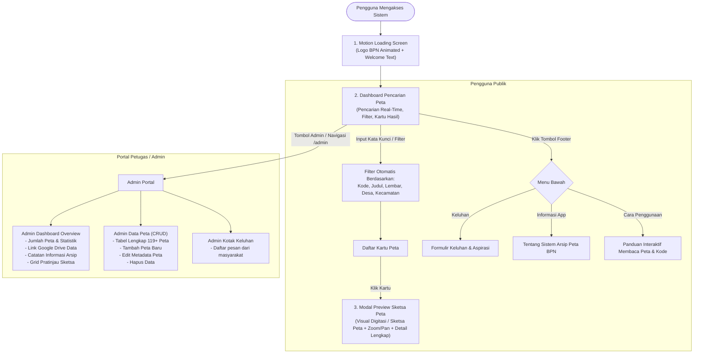

# PRD & Implementation Plan: Sistem Pencarian Peta Lama BPN (Kantor Pertanahan)

Dokumen Spesifikasi Kebutuhan Produk (PRD) dan Rencana Implementasi Teknis untuk pengembangan **Sistem Informasi & Pencarian Arsip Peta Lama Instansi ATR/BPN**.

---

## 1. Goal Description & Executive Summary

Sistem ini bertujuan mencari peta pendaftaran tanah, peta kapling transmigrasi/PIR, peta situasi khusus, dan gambar ukur sejarah di lingkungan Kantor Pertanahan (ATR/BPN Kabupaten Siak).

### Kebutuhan Utama Berdasarkan Permintaan Pengguna:
1. **Motion Loading Screen**:
   - Tampilan pembuka beranimasi penuh estetika (*motion animation*).
   - Teks ucapan: *"Selamat Datang di Pencarian Peta Lama BPN"*.
   - Animasi logo BPN / MagangHub berputar, berdenyut (*pulse/glow*), dan transisi halus ke halaman utama.
2. **Dashboard Publik (Referensi Desain Gambar 1 & Wireframe Gambar 3)**:
   - Palet warna modern *warm cream/sage/emerald forest green* dengan kartu-kartu elevasi bersih (*neomorphic/soft-card styling*).
   - Bilah pencarian utama multi-parameter (*instant live search* berdasarkan Kode, Judul Peta, Petunjuk Lembar, Desa, Kecamatan).
   - Kartu hasil pencarian dengan kode, judul, lembar, lokasi, dan status tanda tangan.
   - **Pratinjau Sketsa Peta**: Klik item membuka modal interaktif yang menampilkan gambar sketsa peta / hasil digitasi peta (lengkap dengan zoom, pan, dan rincian metadata arsip).
   - **Dock Navigasi Bawah / Footer Action**:
     - Tombol **[Keluhan]**: Modal formulir aspirasi/keluhan masyarakat & petugas.
     - Tombol **[Informasi App]**: Modal informasi tujuan aplikasi arsip, sejarah peta, dan legalitas.
     - Tombol **[Cara Penggunaan]**: Modal panduan membaca kode arsip (misal format `1.01`), nomor lembar, dan prosedur permohonan salinan peta.
     - Teks `@copyright Kantor Pertanahan ATR/BPN`.
   - Responsif penuh Desktop & Android/Mobile.
3. **Portal Admin (Referensi Desain Gambar 2 & Wireframe Gambar 4)**:
   - Desain ala *SentinelSoftware* dengan *sidebar* hijau *forest emerald* dan kartu ringkasan status modern.
   - Menu Navigasi:
     - **Dashboard Admin**: Ringkasan jumlah semua peta (119 peta dari 21 proyek), konfigurasi tautan Google Drive penyimpanan berkas peta fisik, pengumuman informasi arsip, dan kisi pratinjau thumbnail sketsa peta.
     - **Data Peta**: Tabel manajemen data peta (CRUD: Tambah, Lihat, Edit, Hapus) dengan pencarian, filter proyek, dan pagination.
     - **Keluhan & Feedback**: Tabel penampung masukan/keluhan dari masyarakat untuk ditindaklanjuti admin.
4. **Kelengkapan Data Awal (Preloaded Dataset)**:
   - Data riil yang diberikan pengguna: **21 Proyek Utama** dan **119 Berkas Peta** (Kode `1.01` s/d `21.01`) lengkap dengan Desa, Kecamatan, Petunjuk Lembar, dan Status Tanda Tangan (Ya/Tidak).
5. **Tech Stack**:
   - **Framework**: Next.js (App Router, React 19 / 18, TypeScript).
   - **Styling**: Tailwind CSS dengan custom theme tokens (Forest Green, Emerald, Warm Cream, Sage, Slate).
   - **Motion & Animations**: Framer Motion (`framer-motion`) untuk transisi halaman, stagger loading, modal springs, dan interaktivitas sketsa.
   - **Icons**: Lucide React (`lucide-react`).
   - **Data Storage**: Client-side localStorage cache dengan in-memory fallback dan API route endpoints untuk persistensi data peta, link Google Drive, dan keluhan.

---

## 2. Referensi Desain & Wireframe Analisis

Visualisasi keterkaitan dokumen acuan yang diunggah pengguna:

````carousel

<!-- slide -->

<!-- slide -->

<!-- slide -->

````

### Pemetaan Elemen Desain ke Komponen:
| Referensi | Komponen yang Diimplementasikan | Karakteristik Visual |
|---|---|---|
| **Gambar 1 (Dashboard)** | Dashboard Utama & Card Grid | Latar belakang krem hangat (`#F7F6F2`), kartu putih melengkung halus (*rounded-2xl*), pill badge hijau gelap, tipografi rapi, widget statistik minimalis. |
| **Gambar 2 (Admin Portal)** | Halaman Admin (`/admin`) | Sidebar warna hijau tua *emerald forest* (`#16805C`), tab menu aktif berbentuk kapsul putih dengan sudut membulat, tabel modern dengan badge status warna pastel (*Approved, Pending, Rejected*). |
| **Gambar 3 (Wireframe Dashboard)** | Loading Motion + Search Screen + Modals + Mobile Dock | Layar animasi pembuka berlogo BPN, bar pencarian besar responsif, daftar kartu hasil, modal detail sketsa peta dengan informasi lengkap, serta 3 modal aksi footer: Keluhan, Informasi App, Cara Penggunaan. |
| **Gambar 4 (Wireframe Admin)** | Admin Overview & Admin Data Peta | Kartu "Jumlah Semua Peta", input "Link Drive Data" dinamis, kartu "Informasi", deretan kartu pratinjau gambar sketsa, serta halaman tabel CRUD data peta dengan filter dan bar pencarian. |

---

## 3. Arsitektur Sistem & Alur Pengguna



---

## 4. Struktur Data & Dataset Preloaded

Aplikasi akan menyertakan data bawaan 21 Proyek Utama dan seluruh data peta yang diberikan:

```typescript
// types/map.ts
export interface MapProject {
  id: number;
  namaProyek: string;
}

export interface MapRecord {
  id: string;
  kode: string;                // contoh: "1.01", "2.15", "13.04"
  proyekId: number;            // relasi ke MapProject (1-21)
  proyekNama: string;          // contoh: "Proyek PIR SUS SEI BUATAN (PTP II)"
  judul: string;               // contoh: "Peta Kapling Pendaftaran Tanah"
  petunjukLembar: string;      // contoh: "43", "47.2-49.216-07/08", "21XVII"
  desa: string;                // contoh: "Pangkalan Pisang", "Dayun"
  kecamatan: string;           // contoh: "Siak Sri Indrapura", "Tualang"
  ttd: boolean;                // Ya (true) atau Tidak (false)
  sketsaUrl?: string;          // URL gambar / sketsa SVG
  keterangan?: string;
  tahunArsip?: string;
  skala?: string;              // contoh: "1:1000", "1:2500"
}

export interface AppComplaint {
  id: string;
  nama: string;
  kontak: string;
  keluhan: string;
  tanggal: string;
  status: 'Menunggu' | 'Ditindaklanjuti' | 'Selesai';
}

export interface SystemConfig {
  googleDriveLink: string;
  informasiArsip: string;
  instansiNama: string;
  kontakAdmin: string;
}
```

### Generator Sketsa Peta Otomatis (Cadastral Vector Graphics):
Untuk peta yang belum memiliki berkas scan resolusi tinggi dari Google Drive, sistem menyediakan **Dynamic Cadastral Map Generator**:
- Merender sketsa peta bidang kadastral asli format SVG yang memuat:
  - Kotak batas kapling/areal (*cadastral parcel blocks*) dengan nomor blok dan penomoran bidang.
  - Tanda mata angin (*compass rose*), koordinat grid, batas jalan/sungai.
  - Skala grafis (*graphic scale bar*), nomor lembar peta, dan stempel/tandatangan digital pengesahan juru ukur BPN.
  - Fitur pengunggahan (*upload custom sketch*) langsung di portal admin untuk mengganti sketsa dengan berkas scan asli.

---

## 5. Rencana Perubahan & Implementasi Berkas

Aplikasi Next.js akan diorganisasikan secara rapi di dalam workspace:

```
maganghub-logo/
├── package.json
├── tailwind.config.js
├── tsconfig.json
├── next.config.ts
├── public/
│   ├── bpn_base_clean.png
│   ├── bpn_globe_restored.png
│   └── logos/
│       └── bpn-logo.svg
├── src/
│   ├── app/
│   │   ├── layout.tsx                # Root Layout dengan Font & Metadata
│   │   ├── page.tsx                  # Dashboard Publik & Loading Motion Screen
│   │   ├── admin/
│   │   │   └── page.tsx              # Admin Portal (SentinelSoftware Style: Dashboard & Data Peta)
│   │   └── api/
│   │       ├── maps/route.ts         # Endpoint API Data Peta (GET, POST, PUT, DELETE)
│   │       ├── complaints/route.ts   # Endpoint API Keluhan
│   │       └── config/route.ts       # Endpoint Konfigurasi Link Drive & Informasi
│   ├── components/
│   │   ├── loading/
│   │   │   └── MotionWelcome.tsx     # Animasi Pembuka Motion keren dengan Logo BPN
│   │   ├── dashboard/
│   │   │   ├── HeaderNav.tsx         # Bilah atas & status profil
│   │   │   ├── SearchHero.tsx        # Input pencarian besar & filter pills
│   │   │   ├── MapResultGrid.tsx     # Grid hasil pencarian peta
│   │   │   ├── MapCard.tsx           # Kartu peta individual
│   │   │   └── FooterDock.tsx        # 3 Tombol Bawah (Keluhan, Info, Cara Pakai) & Copyright
│   │   ├── modal/
│   │   │   ├── MapPreviewModal.tsx   # Modal Detail Sketsa Peta + Zoom/Pan + Metadata
│   │   │   ├── ComplaintModal.tsx    # Modal Formulir Keluhan
│   │   │   ├── AppInfoModal.tsx      # Modal Informasi Aplikasi
│   │   │   └── UserGuideModal.tsx    # Modal Panduan Cara Penggunaan
│   │   ├── admin/
│   │   │   ├── AdminSidebar.tsx      # Sidebar Hijau Sentinel Style
│   │   │   ├── AdminDashboardTab.tsx # Tab 1: Stat Jumlah Peta, Link Drive, Info, Preview
│   │   │   ├── AdminDataTableTab.tsx # Tab 2: Tabel CRUD Data Peta
│   │   │   ├── AdminComplaintsTab.tsx# Tab 3: Daftar Keluhan
│   │   │   └── MapFormModal.tsx      # Modal Tambah/Edit Peta
│   │   └── ui/
│   │       ├── CadastralSketch.tsx   # Visualizer Sketsa Peta SVG Interaktif
│   │       └── StatBadge.tsx         # Pill & Status Indicators
│   ├── data/
│   │   ├── initialProjects.ts        # Daftar 21 Proyek
│   │   └── initialMaps.ts            # 119 Data Peta Lengkap
│   └── lib/
│       ├── storage.ts                # LocalStorage & API Synchronizer
│       └── utils.ts
```

---

## 6. Detail Fitur & Spesifikasi Interaksi

### A. Fitur 1: Motion Welcome Loading Screen
- **Visual**: Background gradient emerald gelap ke charcoal halus dengan partikel cahaya halus.
- **Logo Motion**:
  - Logo BPN di tengah dengan animasi *scale-in*, diikuti efek orbit/glow memutar (*cadastral compass rotation*).
  - Teks: *"Selamat Datang di Pencarian Peta Lama BPN"* dengan animasi huruf bertahap (*staggered character reveal*).
  - Sub-teks: *"Kantor Pertanahan ATR/BPN Kabupaten Siak — Sistem Temu Balik Arsip Peta Spasial"*.
  - Indikator progres halus di bagian bawah yang otomatis meluncur ke Dashboard dalam ~2.5 detik atau dengan tombol *"Masuk Sekarang"*.

### B. Fitur 2: Dashboard Publik (Gambar 1 + Gambar 3)
- **Header**: Salam pengguna modern (*"Pencarian Peta Lama" / "Telusuri 119+ Arsip Peta"*), tombol jalan pintas ke Portal Petugas/Admin, dan status waktu aktif.
- **Pencarian Cerdas**:
  - Pencarian multi-kolom instan: Pengguna bisa mengetik nomor kode (misal `1.08`), nama proyek (`PIR ADB`), nama desa (`Dayun`), kecamatan (`Siak`), atau lembar (`43`).
  - Filter cepat: Filter berdasarkan Kecamatan (Siak Sri Indrapura, Tualang, Minas, Langgam, Sei Apit, Bunga Raya, Mandau) dan Status TTD (Semua, Bertanda Tangan, Belum).
- **Preview Sketsa Peta (Modal)**:
  - Penampil gambar sketsa peta interaktif dengan zoom (100% - 300%) dan pan.
  - Kartu rincian sebelah gambar:
    - Kode Peta & Status Tanda Tangan (Badge Hijau/Kuning).
    - Judul Peta & Nama Proyek Asal.
    - Petunjuk Lembar Peta & Letak Topografi.
    - Lokasi Administratif (Desa/Kelurahan & Kecamatan).
    - Tombol *"Buka Berkas Google Drive"* (jika tersedia).
    - Tombol *"Cetak Lembar Informasi / Lembar Disposisi"*.
- **Footer Dock (Bawah)**:
  - 3 Tombol interaktif sesuai Gambar 3:
    1. **[Keluhan]**: Membuka form nama, kontak, dan pesan keluhan. Data langsung disimpan dan tampil di panel admin.
    2. **[Informasi App]**: Penjelasan latar belakang digitalisasi peta BPN, jenis peta (Kapling, PIR, Gambar Situasi, Gambar Ukur), dan informasi legalitas.
    3. **[Cara Penggunaan]**: Panduan 4 langkah mudah mencari dan memahami peta lama.

### C. Fitur 3: Portal Admin (Gambar 2 + Gambar 4)
- **Sidebar Kiri**:
  - Avatar Admin (*"Petugas Ukur / Arsip BPN"*).
  - Menu aktif berkapsul putih:
    - **Dashboard**: Ringkasan data.
    - **Data Peta**: Manajemen tabel.
    - **Keluhan Masuk**: Kotak masuk masukan pengguna.
    - **Kembali ke Pencarian Publik**: Tombol cepat untuk beralih mode.
- **Tampilan Dashboard Admin**:
  - **KPI Card**: Jumlah Semua Peta (119 Peta), Jumlah Proyek (21 Proyek), Persentase Terverifikasi (%).
  - **Card Link Drive Data**: Input URL folder Google Drive data scan peta; admin dapat mengganti dan menyimpan link ini kapan saja.
  - **Card Informasi**: Editor pengumuman/catatan operasional juru ukur.
  - **Grid Pratinjau Gambar**: 3+ kartu thumbnail sketsa peta teratas yang dapat diklik untuk pratinjau cepat.
- **Tampilan Data Peta (CRUD Table)**:
  - Tabel interaktif dengan kolom: No, Kode, Judul/Nama Peta, Petunjuk Lembar, Lokasi (Desa, Kecamatan), Status TTD, dan Tombol Aksi (Lihat, Edit, Hapus).
  - Tombol **[+ Tambah Peta Baru]** untuk memasukkan data arsip baru.

---

## 7. User Review Required

> [!IMPORTANT]
> **Keputusan Lokasi Berkas Proyek**:
> Workspace saat ini berlokasi di `C:\Users\asus\Documents\LOGO\maganghub logo`. Aplikasi Next.js akan dibangun langsung di dalam workspace ini dengan struktur berkas `src/`, `public/`, dan `package.json`, tanpa mengganggu berkas logo yang sudah ada. Mohon konfirmasi bila Anda ingin Next.js berada di root workspace ini (direkomendasikan) atau di subfolder khusus (seperti `./peta-bpn`).

> [!NOTE]
> **Ketersediaan Gambar Sketsa Asli**:
> Dataset saat ini memuat metadata tekstual 119 peta. Sistem ini akan menyematkan generator visual sketsa peta kadastral berpresisi tinggi (SVG) untuk seluruh 119 peta secara otomatis, serta menyediakan kolom integrasi Google Drive dan fitur unggah gambar agar petugas dapat mengunggah hasil scan asli sewaktu-waktu.

---

## 8. Verification Plan

### Automated Tests
1. **Build Test**:
   ```powershell
   npm run build
   ```
   Memastikan tidak ada error TypeScript, linting, atau masalah bundler Next.js.
2. **Data Integrity Test**:
   Memvalidasi bahwa seluruh 21 proyek dan 119 item peta ter-load dengan benar ke dalam sistem dan terhitung 119 records.

### Manual Verification
1. **Layar Loading Motion**:
   - Buka halaman root `/`.
   - Pastikan animasi pembuka muncul dengan teks *"Selamat Datang di Pencarian Peta Lama BPN"*, logo BPN beranimasi halus, lalu beralih mulus ke dashboard.
2. **Dashboard Publik**:
   - Ketik kata kunci pada bilah pencarian: ketik `"Dayun"`, `"1.08"`, `"PIR"`, atau `"43"`.
   - Pastikan kartu hasil pencarian muncul secara responsif dan akurat.
   - Klik salah satu kartu hasil; pastikan modal pratinjau sketsa peta dan informasinya tampil lengkap.
   - Uji 3 tombol dock bawah: klik `[Keluhan]` (coba kirim masukan), klik `[Informasi App]`, dan klik `[Cara Penggunaan]`.
   - Periksa tampilan pada mode desktop dan simulasi layar smartphone/Android.
3. **Portal Admin**:
   - Klik navigasi ke `/admin`.
   - Periksa kartu "Jumlah Semua Peta" (menampilkan 119), coba ubah "Link Drive Data" dan simpan.
   - Buka tab "Data Peta", lakukan pencarian di tabel, coba edit salah satu data, dan coba tambah 1 data peta baru.
   - Buka tab "Keluhan Masuk", pastikan pesan keluhan yang dikirim dari dashboard publik tercatat dengan rapi.
